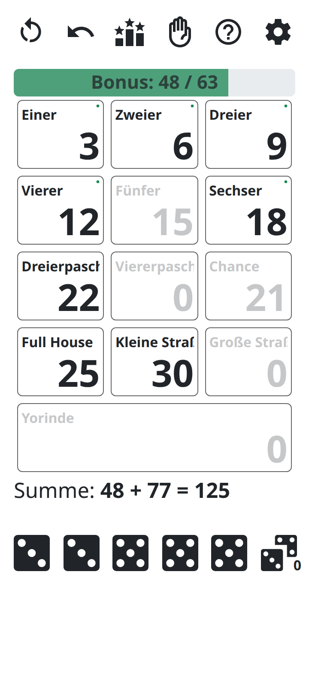

# Würfelspiel-Block im Browser

**Yorinde** ist ein Spielblock für das klassische Würfelspiel mit fünf Würfeln: Einer bis Sechser,
Pasch, Full House, Straßen und fünf Gleiche. Man kann mit echten Würfeln spielen und nur die Augen
eintragen, oder die Seite würfelt selbst. Sie läuft im Browser und lässt sich wie eine App auf den
Startbildschirm legen.

**Öffnen:** <https://hansmaulwurf23.github.io/yorinde/>

## So funktioniert's

- **Würfeln:** Unten liegen fünf Würfel. Im Würfelmodus würfelt der Knopf rechts daneben bis zu
  dreimal; angetippte Würfel bleiben liegen. Mit der Hand oben wechselt man zum Eintragen echter
  Würfe.
- **Eintragen:** Ein Feld antippen setzt die Punkte für den aktuellen Wurf. Grau stehen die Punkte,
  die der Wurf in den noch freien Feldern bringen würde. Passt der Wurf nicht, wird das Feld mit 0
  gestrichen und die Seite sagt, warum.
- **Bonus:** Der Balken oben zeigt, wie weit es noch bis zu den 63 Punkten für den Bonus ist.
- **Rückgängig** hebt die letzte Eintragung auf, wenn man sich verklickt hat.
- **Bestenliste:** Fertige Spiele landen in einer Bestenliste mit Statistik über alle Spiele. Sie
  lässt sich als Datei herunterladen und wieder einlesen.

Der Spielstand bleibt im Browser gespeichert. Ein Konto, Werbung oder eine Verbindung zu einem
Server gibt es nicht. Die Oberfläche gibt es auf Deutsch und Englisch, hell oder dunkel.
